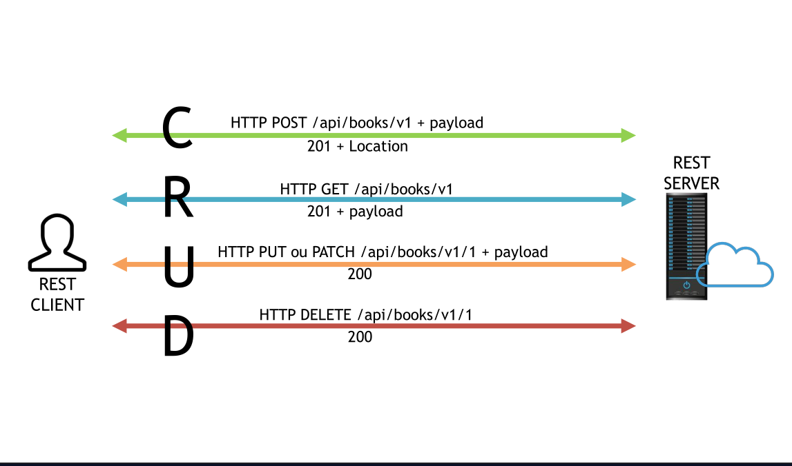

# Verbos HTTP e o REST

## POST - CREATE

### Utilizado para inserir recurso:

- **Parâmetros Suportados**
    - URL --> PATH ou QUERY PARAMS
    - Via HEADER
    - Via BODY

Em uma aplicação REST perfeita quando uma operação é executada com sucesso, retorna-se o status code 200 ou 201.  
HTTP status 201 --> retorna um Location header com o link para recurso recém criado.
As novas informações são passadas no body da requisição + token no HEADER

---

## GET - READ

### Utilizado para selecionar ou recuperar um recurso:

- **Parâmetros Suportados**
    - URL --> PATH ou QUERY PARAMS
    - Via HEADER
    - NÃO suporta paramêtros via BODY

Em um “cenário feliz”, uma requisição GET retorna uma representação em XML ou JSON e um HTTP status code 200 (OK).  
Em um cenário de erro o retorno mais comum é 404 (NOT
FOUND) ou 400 (BAD REQUEST).

---

## PUT ou PATCH - UPDATE

### Utilizado para atualizar oiu modificar um recurso

- **Parâmetros Suportados**
    - URL --> PATH ou QUERY PARAMS
    - Via HEADER
    - Via BODY

Colocamos um recurso conhecido no (body- corpo da
requisição) contendo novas informações que representam o recurso original + ID;  
\*\* Obrigatorio envio do ID

Um update bem sucedido, retorna um status code 200 (ou 204 quando não retorna nenhum conteúdo no body).

- PATCH - atualização parcial -- sem body
    - serve para ganhar performance

---

## DELETE - DELETE

### Utilizado ara remover um recurso

- **Parâmetros Suportados**
    - URL --> PATH ou QUERY PARAMS
    - Via HEADER
    - Via BODY

 

Em uma deleção bem sucedida retorna-se um status code 200
(OK) juntamente com um response body, possivelmente uma
representação do item deletado (o que acaba por demandar muita banda), ou uma response customizada;

Mais correto retornar o status code **204 (NO CONTENT)** sem response body ou **um status code 204** sem corpo, ou **JSEND-style response** com um **status code 200** são as responses mais recomendadas.

---

 

## Métodos idempotentes

Métodos idempotentes retornam o mesmo resultado, independentemente de quantas vezes são chamados. **GET, PUT e DELETE são idempotentes**, enquanto POST não é.

---

 

## Verbos menos conhecidos

## PATCH

- Pode ser usado para realizar **updates parciais** de
  um recurso.

    Por exemplo, quando você precisar alterar **apenas um campo**
    em um recurso, executar um PUT com todo o objeto é pesado e acarreta em um maior consumo de banda.
    - Use-o com **moderação** pois colisões entre múltiplas PATCH requests são mais perigosas que colisões entre PUT requests por que exige que o cliente tenha informações básicas do recurso ou irão corrompê-lo.

## HEAD

- Possui uma funcionalidade similar ao verbo GET, exceto pelo fato do servidor retornar uma response line e headers, mas sem um entity-body.

## TRACE

- O verbo TRACE é usado para **recuperar o conteúdo de uma requisição HTTP** de volta podendo ser usado com o propósito de **debug** durante o processo de desenvolvimento.

## OPTIONS

- Muito utilizado em frameworks - **Angular / React**

- O verbo OPTIONS é usado pelo cliente para encontrar operações HTTP e outras opções suportadas pelo servidor. O cliente pode especificar uma URL para o verbo OPTIONS ou um asterisco (\*) para se referir a todo o servidor.

## CONNECT

- O verbo CONNECT é usado pelo cliente para estabelecer uma conexão de rede com um servidor via HTTP.
